# Manual do Usuário — AGIA (Prospecção Tecnológica)

*Atualizado em 26/10/2026.*

O AGIA apoia a prospecção tecnológica. A partir de um tema, o sistema busca patentes e
artigos, extrai termos, analisa o cenário (depositantes, instituições, classificações e
evolução no tempo) e monta um relatório técnico no padrão REPTEC/AGITEC, em LaTeX e PDF.

O sistema precisa estar instalado e configurado pelo administrador (manual de instalação e
manual de configuração).

---

## 1. Conceitos básicos

| Termo | Significado |
|---|---|
| **Sessão** (ou **prospecção**) | Uma pesquisa completa, do tema ao relatório. Pode ser salva e retomada. |
| **Tema** | O assunto da prospecção. É o único campo obrigatório. |
| **Refinamento** | Variações mais específicas do tema, sugeridas pela IA. |
| **Query exploratória** | Expressão de busca restrita, para conhecer o campo. |
| **Query final** | Expressão de busca ampla, que alimenta as análises e o relatório. |
| **Termos** | Palavras e expressões extraídas automaticamente de títulos e resumos. |
| **Curva S** | Gráfico da evolução cumulativa de documentos no tempo. |

---

## 2. Navegação

A **barra lateral** dá acesso às telas principais. Pode ser recolhida, deixando só os ícones.

| Item | Tela |
|---|---|
| **Start** | Nova prospecção, nas quatro etapas. |
| **Settings** | Configurações do sistema. |
| **Statistics** | Estatísticas de todas as prospecções. |
| **Search** | Sessões salvas: retomar ou abrir relatórios. |

No canto superior direito ficam o menu **Documentação** (guia do usuário, referência da API e
perguntas frequentes), o link **Sobre** e a versão do sistema.

Durante uma prospecção, o menu fica bloqueado para evitar perda de progresso não salvo. Salve
o progresso ou conclua a sessão antes de sair.

A **barra de etapas** no topo mostra onde você está:

| # | Etapa | Subetapas |
|---|---|---|
| 1 | Input Inicial | Refinamento de Parâmetros |
| 2 | Exploração Inicial | Resultados Iniciais · Amostragem de Termos |
| 3 | Exploração Final | Análise de Resultados · Criação de Gráficos |
| 4 | Geração do Relatório | — |

---

## 3. Etapa 1 — Parâmetros da prospecção

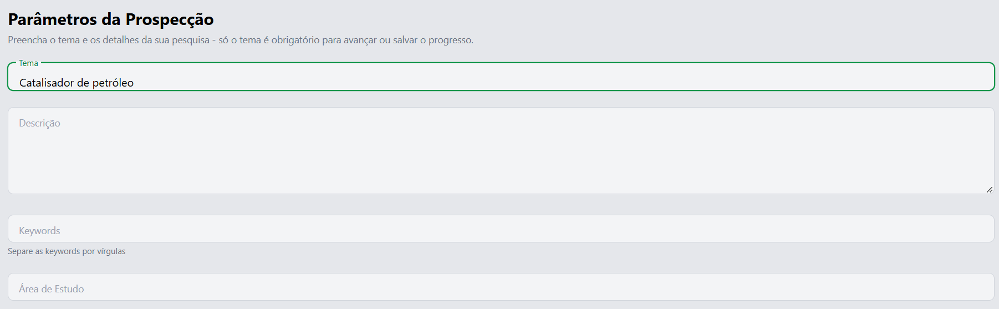

| Campo | Obrigatório | Como preencher |
|---|---|---|
| **Tema** | Sim | O assunto principal. Ex.: "baterias de estado sólido". |
| **Descrição** | Não | Detalhes do projeto. Quanto mais claro, melhor o refinamento. |
| **Keywords** | Não | Palavras-chave separadas por vírgulas. |
| **Área de Estudo** | Não | Campo de conhecimento. Ex.: "Engenharia de Materiais". |

Botões do rodapé:

- **Refinar parâmetros**: abre o refinamento, em que a IA sugere quatro variações do tema.
- **Gerar Query**: pula o refinamento e segue com o tema como foi digitado.
- **Avançar**: próxima etapa, quando já existe resultado para o que você preencheu.
- **Cancelar**: encerra sem salvar. Uma sessão já salva continua na tela Search.

O rótulo muda conforme o que já foi gerado. Se aparecer **Avançar** ou **Ver parâmetros**, o
sistema reaproveita o resultado anterior, porque nada relevante mudou.

Editar um campo aqui invalida o refinamento e as etapas seguintes, e a IA precisa gerar de novo.

### 3.1 Refinamento

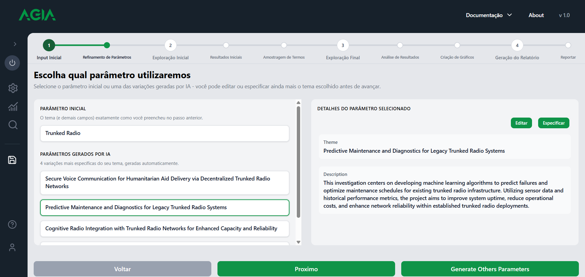

- À esquerda, **Parâmetro inicial** mostra o tema digitado, e **Parâmetros gerados por IA**
  lista as quatro variações.
- À direita, **Detalhes do parâmetro selecionado** traz os botões **Editar** (alteração
  manual, sem custo de IA) e **Especificar** (a IA refina ainda mais a variação).
- Rodapé: **Voltar**, **Próximo** e **Generate Others Parameters** (gera um novo conjunto).

Variações mais específicas tendem a retornar poucos resultados. Se isso acontecer, escolha uma
mais ampla.

---

## 4. Etapa 2 — Exploração inicial

O objetivo é descobrir o campo com uma busca restrita e uma amostra pequena.

### 4.1 Escolha da query

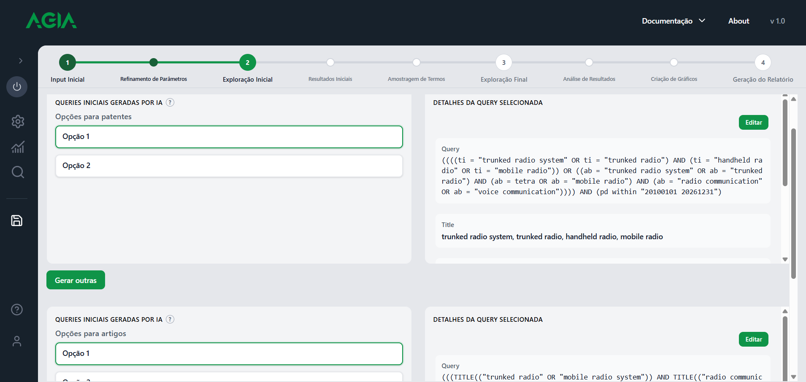

A tela tem duas seções independentes, uma para **patentes (OPS)** e outra para **artigos
(Scopus)**, cada uma com opções numeradas (Opção 1, Opção 2 etc.).

- Clique numa opção para ver a query completa e o título com os termos usados.
- **Editar** altera a query manualmente. **Gerar outras** pede novas opções à IA.
- O **medidor de complexidade** avisa quando a query tende a falhar. Simplifique a query se ele
  indicar complexidade alta.

**Próximo** executa a busca exploratória. Se a mesma query já foi buscada, os resultados são
reaproveitados.

### 4.2 Resultados iniciais

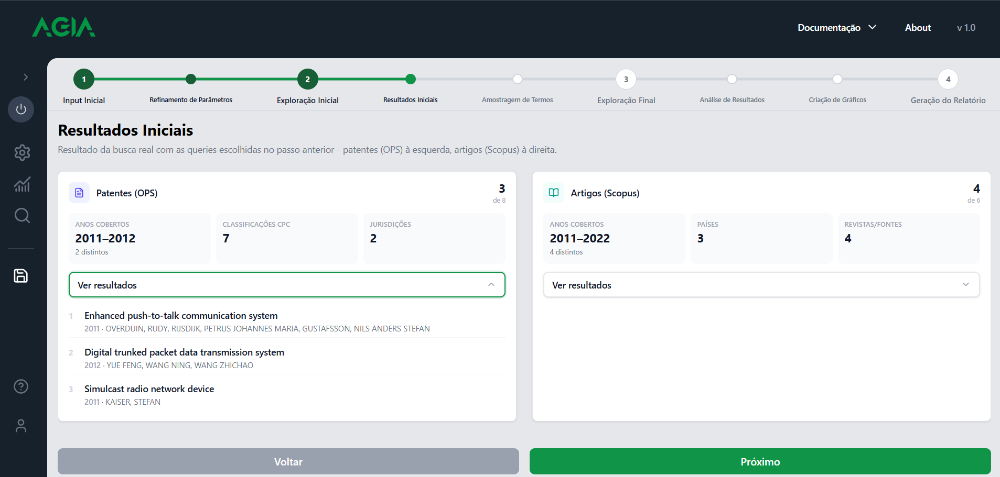

Tela somente leitura, com a amostra de patentes (à esquerda) e de artigos (à direita). Cada
cartão mostra o número de documentos e alguns indicadores. **Ver resultados** lista os
documentos.

Confira se os documentos têm relação com o tema. Se não tiverem, volte e ajuste o refinamento
ou a query.

### 4.3 Amostragem de termos

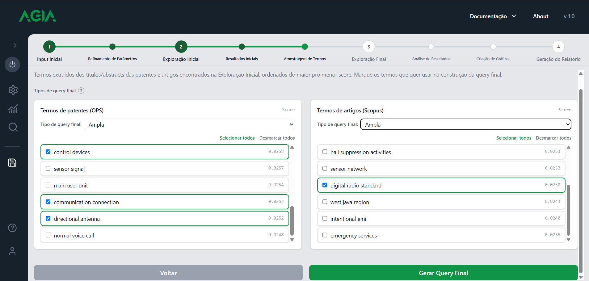

Os termos são extraídos automaticamente dos títulos e resumos da amostra, sem IA generativa.
Os mesmos documentos sempre geram os mesmos termos. Para obter outros, mude a query
exploratória.

- Os termos aparecem ordenados por score, em duas colunas (patentes e artigos).
- Marque os termos que devem entrar na query final. **Selecionar todos** e **Desmarcar todos**
  agilizam a escolha.
- O **Tipo de query final** define a abrangência da busca final:
  - **Específica**: mais restrita, com menos ruído e menos resultados.
  - **Balanceada**: meio-termo.
  - **Ampla**: mais resultados e mais ruído.

**Gerar Query Final** monta a query da próxima etapa. A IA só é chamada de novo se os termos
marcados ou o tipo mudaram desde a última geração.

---

## 5. Etapa 3 — Exploração final

### 5.1 Revisão da query final

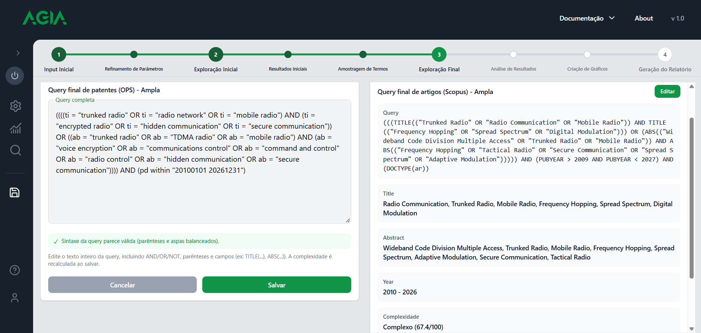

- A query de patentes é editável. O indicador **Sintaxe da query parece válida** aparece quando
  parênteses e aspas estão balanceados. Use **Salvar** após editar; a complexidade é recalculada.
- A query de artigos mostra os campos **Title**, **Abstract**, **Year** e **Complexidade**.
- **Gerar de novo** cria outra versão da query.
- **Confirmar e buscar** executa a busca final. Ela sempre roda, mesmo que a query já tenha sido
  buscada, e alimenta todas as análises e o relatório.

Se a busca não trouxer resultados, a tela informa isso. Amplie a query (variante **Ampla** ou
mais termos) e tente de novo.

### 5.2 Análise de resultados

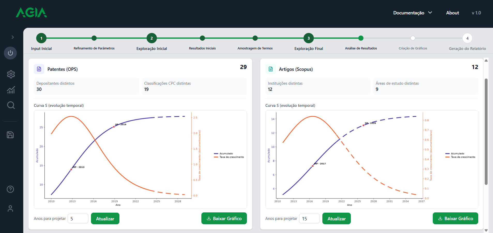

- **Patentes**: depositantes distintos e classificações CPC distintas.
- **Artigos**: instituições distintas e áreas de estudo distintas.
- **Curva S**: a linha **Acumulado** mostra o total de documentos ao longo dos anos; a linha
  **Taxa de crescimento**, a velocidade do crescimento. Os pontos **GP**, **MP** e **SP**, quando
  aparecem, marcam fases do ciclo de vida da tecnologia.
- **Anos para projetar** define quantos anos à frente a curva é estendida. A parte tracejada é a
  projeção. **Atualizar** recalcula. **Baixar Gráfico** salva a imagem.

Quando o ajuste não é confiável, o gráfico mostra um aviso e deixa de exibir a projeção. A curva
continua visível e deve ser lida com cautela. Buscas com mais anos e mais documentos costumam
resolver.

### 5.3 Criação de gráficos

Esta tela é automática. Ela salva a sessão, verifica se a amostra cobre bem o campo (inferência
estatística), pede mais resultados à busca final quando a amostra é insuficiente e gera os
gráficos: top depositantes e instituições, distribuição de CPC e de áreas, histórico anual e
curva S.

Ao terminar, a tela avança para a Geração do Relatório. Se algo falhar, use **Tentar novamente**.
Gráficos já gerados são reaproveitados.

---

## 6. Etapa 4 — Geração do relatório

### 6.1 Metadados do REPTEC

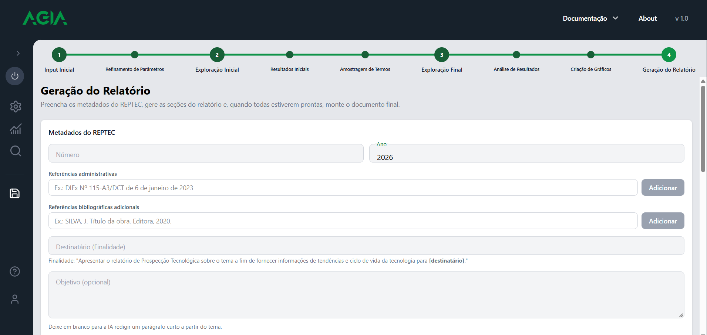

| Campo | Observação |
|---|---|
| **Número** | Ex.: "001". |
| **Ano** | Vem preenchido com o ano atual. |
| **Referências administrativas** | Ex.: "DIEx Nº 115-A3/DCT de 6 de janeiro de 2023". Use **Adicionar** para cada item. |
| **Referências bibliográficas adicionais** | Em ABNT. Use **Adicionar** para cada item. |
| **Destinatário (Finalidade)** | Obrigatório. Preenche o `[destinatário]` da frase de finalidade. |
| **Objetivo** | Opcional. Se ficar vazio, a IA escreve um parágrafo a partir do tema. |
| **Local** | Linha antes das assinaturas. Ex.: "Rio de Janeiro". |
| **Assinaturas** | Elaborado, Revisado e Aprovado por: nome, posto/graduação e função. |

Regras de validação:

- Valores de preenchimento, como "teste" ou "sdasd", são recusados.
- **Elaborado por** é obrigatório. Revisado e Aprovado por podem ficar vazios.
- Pelo menos um assinante, com nome, posto/graduação e função, é obrigatório.

Confira os dados antes de montar o documento. Se algo mudar depois, o texto gerado pela IA pode
não bater com os dados.

### 6.2 Seções do relatório

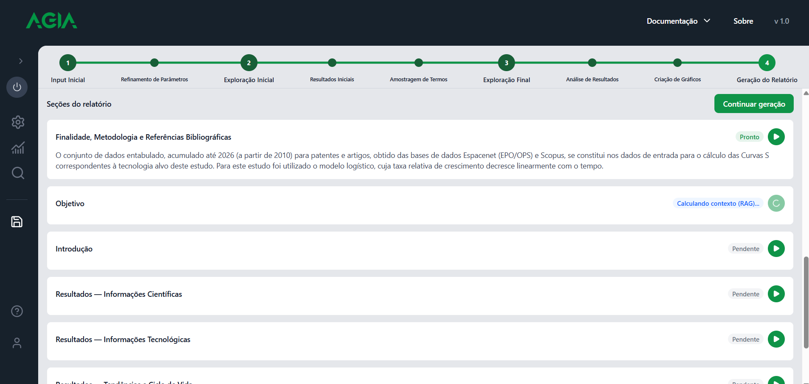

**Continuar geração** gera as seções pendentes, em sequência. Cada seção também tem seu botão de
play.

- **Finalidade, Metodologia e Referências Bibliográficas**: montadas pelo sistema a partir dos
  dados do estudo. A metodologia não é gerada pela IA.
- **Objetivo**, **Introdução**, **Resultados — Informações Científicas**, **Resultados —
  Informações Tecnológicas** e **Resultados — Tendências e Ciclo de Vida**: textos gerados pela
  IA a partir dos trechos mais relevantes dos documentos e dos gráficos.

Cada seção mostra o andamento: **Calculando contexto (RAG)**, depois a geração do texto, até
**Pronto**. Se uma seção falhar, use **Continuar geração** ou gere-a de novo.

O texto cita os documentos recuperados. Citações que não correspondam a um documento do contexto
da seção são removidas.

### 6.3 Montar o .tex

**Montar .tex** monta o documento LaTeX com as seções e os gráficos e abre o editor.

> **Atenção:** montar o .tex **conclui a sessão**. A partir daí, a pesquisa (queries, termos e
> buscas) não pode mais ser editada, só o texto do relatório.

Para refazer o documento do zero, use **Remontar .tex** no editor. Ele pede confirmação e
descarta as edições manuais.

---

## 7. Editor do relatório

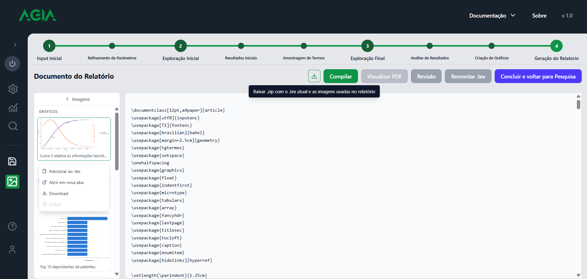

### 7.1 Barra de ações

- **Baixar**: `.zip` com o `.tex` atual e as imagens, para compilar ou editar fora do sistema.
- **Compilar**: gera o PDF.
- **Visualizar PDF**: abre a última compilação. Fica desabilitado até a primeira compilação.
- **Revisão**: abre o painel de revisão (seção 7.3).
- **Remontar .tex**: refaz o documento e descarta as edições manuais.
- **Concluir e voltar para Pesquisa**: encerra o fluxo e abre a tela Search.

Compilar, revisar, inserir imagens e baixar o .zip nunca descartam suas edições. Só
**Remontar .tex** faz isso.

### 7.2 Painel de imagens

O painel **Imagens**, à esquerda, lista os **Gráficos** (gerados pela busca) e os **Anexos**
(imagens que você envia). Para cada imagem:

- **Adicionar ao .tex**: insere a figura na posição do cursor.
- **Abrir em nova aba**, **Download**.
- **Excluir**: remove anexos. Gráficos gerados não podem ser excluídos.

Para enviar uma imagem própria, use o botão **+** ao lado de **Anexos**.

> Excluir um anexo ainda referenciado no `.tex` faz a compilação falhar com "arquivo não
> encontrado". Remova a referência antes.

### 7.3 Revisão

O botão **Revisão** abre o painel à direita, com sugestões de ortografia, acentuação,
concordância e LaTeX, e a origem de cada uma (por exemplo, LanguageTool).

- Marque as sugestões que quer aplicar e clique em **Aplicar selecionadas**. Nada é alterado sem
  sua aprovação.
- **Revisar de novo** refaz a análise do texto atual.
- **Revisão com IA** pede uma revisão adicional. Depois da primeira vez, o botão passa a se
  chamar **Refazer com IA**.

Uma sugestão só é aceita se o trecho existir literalmente no texto e se a mudança for de acento
ou concordância. Mudanças de tempo verbal, pontuação ou maiúsculas são recusadas.

### 7.4 Pacotes LaTeX e limites do compilador

O PDF é gerado no servidor de compilação, **sem internet**. Só os pacotes já instalados nele
podem ser usados.

**Já carregados pelo template** (não precisam de `\usepackage`): `graphicx`, `float`, `tabularx`,
`array`, `enumitem`, `caption`, `hyperref`, `setspace` e `babel` (português). O template também
configura `geometry`, `fancyhdr`, `microtype`, `lastpage`, `titlesec`, `tocloft`, `indentfirst`
e `tgtermes`.

**Não disponíveis:** `multirow`, `makecell`, `siunitx`, `wrapfig`, `ulem` e `soul`. Um
`\usepackage` deles interrompe a compilação com "File … .sty not found".

Limites:

- Usa **pdflatex**: `fontspec`, XeLaTeX e LuaLaTeX não funcionam.
- Caracteres fora do alfabeto latino não compilam.
- A compilação tem limite de 120 segundos.
- No texto que você digita, `%`, `&`, `_` e `#` devem ser escritos como `\%`, `\&`, `\_` e `\#`.
  O texto gerado pela IA e os campos do formulário já saem escapados.

Figuras e quadros seguem o padrão REPTEC: título acima ("Figura N:" ou "Quadro N:"), imagem
centralizada e "Fonte:" abaixo. Rótulos de figura usam `fig:`, e os de quadro, `quadro:`.

---

## 8. Salvar, voltar, continuar e concluir

- **Salvar Progresso** grava a sessão no servidor. A primeira vez cria a sessão; as seguintes
  atualizam a mesma. O tema é obrigatório. Ele fica indisponível enquanto a IA processa algo.
- **Voltar** e **Avançar** não descartam o que já foi gerado, e não chamam a IA de novo.
- **Continuar pesquisa** (na tela Search) reabre uma sessão pendente na etapa em que foi salva,
  com documentos e termos restaurados, sem consultar as bases de novo.
- A sessão é **concluída** ao clicar em **Montar .tex**. Depois disso, a pesquisa não pode mais
  ser editada; só o texto do relatório.

---

## 9. Tela Search

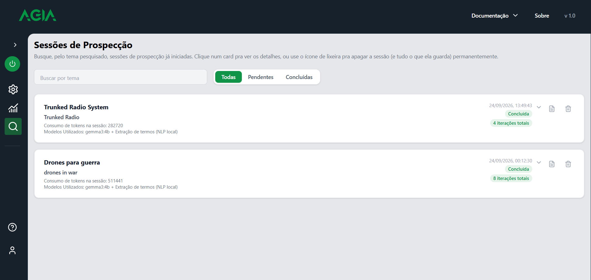

A tela **Sessões de Prospecção** lista as sessões salvas. Use o campo **Buscar por tema** e os
filtros **Todas**, **Pendentes** e **Concluídas**. Cada cartão mostra o tema, o consumo de tokens,
os modelos usados, a data, o status e o número de iterações (rodadas de busca).

- Seta: expande os detalhes.
- Documento: abre o relatório (sessões concluídas).
- Lixeira: apaga a sessão e tudo o que ela guarda. **Não é reversível.**
- **Continuar pesquisa** reabre uma sessão pendente. **Ver Relatório** abre o editor de uma
  sessão concluída.

---

## 10. Tela Statistics

A tela **Estatísticas das nossas prospecções** mostra o conjunto de todas as sessões: quantas
estão concluídas ou pendentes, a evolução dos últimos 30 dias, o número de iterações por sessão e
o consumo médio de tokens.

---

## 11. Tela Settings (visão do usuário)

As alterações são salvas automaticamente, sem botão de salvar. Alterar um parâmetro afeta todas
as prospecções seguintes, não só a atual.

- **Inteligência Artificial**: qual modelo atende cada uso (temas candidatos, query exploratória,
  query final, redação do relatório e revisão). Ver manual de configuração.
- **Busca**, **Extração de Termos**, **Relevância & Qualidade** e **Inferência Estatística**:
  parâmetros da pesquisa. Ver manual de configuração.
- **Geral**: imagem de capa do relatório, idioma da revisão, modelo do KeyBERT e tempo limite do
  Ollama.

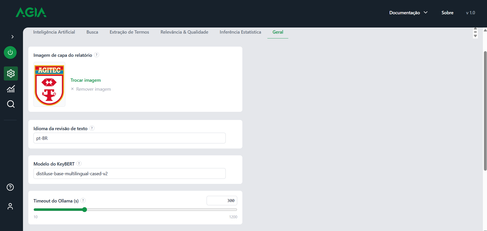

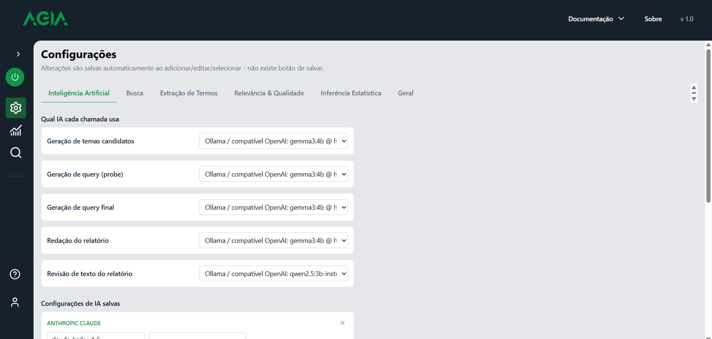

---

## 12. Limitações

- A busca depende das bases externas. Se estiverem lentas ou indisponíveis, os resultados podem
  sair incompletos.
- Sem credenciais de busca, as bases não retornam documentos. Peça ao administrador para
  conferi-las e reiniciar o backend.
- Os textos da IA usam só os trechos mais relevantes de cada seção. Um documento pouco relevante
  pode não aparecer no texto; você pode citá-lo manualmente no editor.
- Amostras pequenas (poucos anos ou pouca variedade) geram análises menos confiáveis, sobretudo
  para depositantes e instituições.
- Se a IA demorar muito, o modelo pode estar rodando em CPU. Peça ao administrador para verificar
  a aceleração por placa de vídeo.
